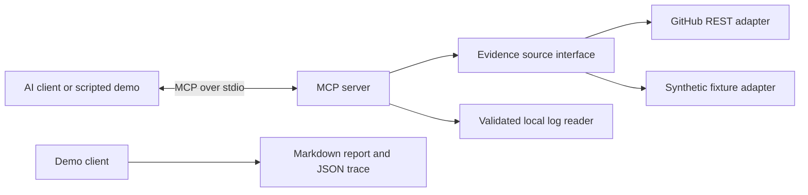

# GitHub Issue Investigator

An evidence-first MCP server for investigating software regressions. Connect an MCP-compatible AI client to search issues, inspect release diffs, and correlate sanitized logs in one workflow.

The included demo investigates **“Why does login return 401 after v1.4.0?”** It finds a clock-unit change, correlates error logs, and runs an executable reproducer. It works offline and needs no API keys.

## Run the demo

Requires Node.js 22+ and npm.

```bash
npm ci
npm run demo
```

The demo starts a real MCP server as a child process, discovers its tools, and calls all four over stdio. Outputs:

- `artifacts/investigation.md`: evidence, finding, confidence rationale, and verification plan.
- `artifacts/trace.json`: actual MCP responses, arguments, and measured tool durations.

The demo's orchestration and report are scripted against synthetic fixtures. Live reasoning is performed by your connected AI client; this project does not bundle a model or require an OpenAI API key. Demo links use `demo://` and identify fixture records rather than real GitHub pages.

## Connect an AI client

Build first with `npm run build`. Add the following to a client that supports `mcpServers` configuration, replacing the path with your absolute checkout path. Other clients may use a different configuration format.

```json
{
  "mcpServers": {
    "github-investigator": {
      "command": "node",
      "args": ["/absolute/path/to/github-issue-investigator/dist/server.js"],
      "env": { "INVESTIGATOR_MODE": "demo" }
    }
  }
}
```

Ask the client:

> Read investigator://guide. Investigate login failures after v1.4.0 compared with v1.3.9. Cite the issue, patch, and log timestamps. Separate observations from hypotheses and propose a regression test.

The server also exposes the `investigate-regression` prompt with `symptom`, `base`, and `head` arguments.

### Investigate a real repository

Change the server environment in your client configuration:

```json
{
  "INVESTIGATOR_MODE": "github",
  "GITHUB_REPO": "owner/repository",
  "LOG_FILE": "/absolute/path/to/sanitized-logs.json"
}
```

Public GitHub repositories can be read without a token. An optional `GITHUB_TOKEN` increases available API quota or grants access to authorized private repositories. Use a fine-grained token restricted to the target repository with read access to Issues and Contents. Supply secrets through your client's environment facilities; do not commit them.

`LOG_FILE` is optional. Without it, `search_logs` explicitly reports that logs are unavailable. Live mode never falls back to demo logs. Logs are a JSON array:

```json
[
  {
    "timestamp": "2026-10-12T10:02:00Z",
    "level": "error",
    "release": "v1.4.0",
    "message": "login SESSION_EXPIRED"
  }
]
```

Levels: `info`, `warn`, `error`. Files are limited to 2 MB and 10,000 entries. `.env.example` documents variables; `.env` files are not loaded automatically. For local shell execution, Node supports `node --env-file=.env dist/server.js`.

## MCP surface

| Primitive | Name | Purpose |
| --- | --- | --- |
| Tool | `search_issues(query)` | Search plain terms in one configured repository; up to 20 live results |
| Tool | `get_issue(number)` | Read issue title, body, state, and source URL |
| Tool | `compare_commits(base, head)` | Inspect release commits and bounded file patches |
| Tool | `search_logs(query, release?)` | Literal substring search in configured logs; up to 50 entries |
| Resource | `investigator://guide` | Investigation workflow and evidence handling |
| Prompt | `investigate-regression` | Request cited findings, uncertainty, and a verification plan |

## Architecture



`src/mcp.ts` owns the protocol surface. `EvidenceSource` isolates GitHub retrieval from protocol code and enables deterministic integration tests. The GitHub adapter validates upstream responses, bounds patches, uses request timeouts, and returns actionable authentication and rate-limit errors. Logging to stdout is reserved for the MCP protocol in server mode.

## Trust boundaries and limitations

- All tools are read-only. The server does not create issues, modify code, or execute repository content.
- The repository and log path are chosen by the operator. Tool callers cannot supply URLs, repositories, or file paths.
- Retrieved issues, patches, and logs are untrusted content. The guide and prompt instruct clients to treat them as evidence. These instructions cannot guarantee a model will resist prompt injection.
- Common credential patterns are redacted from live issue bodies, patches, and log messages. Redaction is best-effort: sanitize logs before use. Retrieved content goes to the connected client and potentially its model provider.
- Search returns one page. Comparisons retrieve up to 100 commits and 50 file patches. Missing or bounded patches and incomplete searches are flagged; check `truncated` before concluding the evidence is complete.
- Issue comments, GitHub Enterprise, remote HTTP transport, hosted authentication, and automatic live diagnosis are outside this first version.
- The SDK v1 maintenance line is pinned through the lockfile. See [official SDK documentation](https://ts.sdk.modelcontextprotocol.io/) for supported protocol versions. This server uses local stdio transport.

## Verification

```bash
npm run check
npm test
npm run demo
```

Tests cover MCP discovery and tool calls, prompt/resource access, invalid inputs, repository scoping, rate-limit handling, credential redaction, and expiry boundary behavior. GitHub HTTP responses are mocked; the offline suite does not depend on network availability. CI runs these checks and uploads the demo artifacts.

## Portfolio walkthrough

1. Explain the problem: debugging requires joining issues, release changes, and runtime evidence.
2. Run `npm run demo` and show the tool trace and report.
3. Show the seconds/milliseconds patch and the reproducer in `src/reproducer.ts`.
4. Connect an AI client and repeat the investigation using the exposed tools.
5. Discuss tradeoffs: bounded evidence, explicit uncertainty, repository scoping, and adapter isolation.

See [design notes](docs/design.md) for decisions and a follow-up roadmap.

## References

- [MCP TypeScript SDK](https://ts.sdk.modelcontextprotocol.io/)
- [GitHub issue search API](https://docs.github.com/en/rest/search/search#search-issues-and-pull-requests)
- [GitHub compare API](https://docs.github.com/en/rest/commits/commits#compare-two-commits)
