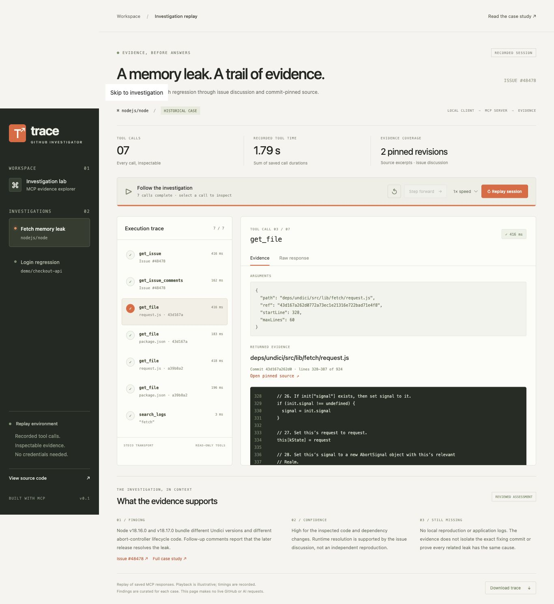

# Two-minute portfolio walkthrough

This is a presentation guide for the working dashboard, not a prerecorded video. Start with `npm run dashboard` and open the printed local URL. No credentials are needed.

| Time | Show | Explain |
| --- | --- | --- |
| 0:00–0:15 | Historical Node.js case and session metrics | “This project gives an AI client read-only GitHub investigation tools through MCP. This dashboard replays the actual saved responses.” |
| 0:15–0:35 | Click Replay session, then pause and step | “Each tool call has inspectable arguments, output, and a measured duration. Playback is illustrative; the durations come from the original run.” |
| 0:35–0:55 | Select get_issue_comments | “Reading the discussion changes the assessment. A comment challenges the original version claim, while later comments report resolution.” |
| 0:55–1:15 | Select the first get_file, then the later revision | “File reads resolve the supplied reference to a commit SHA. These excerpts show the controller-lifecycle change and provide stable source citations.” |
| 1:15–1:35 | Select search_logs and review the findings | “The tool explicitly says logs are missing. The case distinguishes verified code changes from runtime behavior reported by others.” |
| 1:35–1:50 | Switch to Login regression, select compare_commits | “The controlled scenario uses a seconds-versus-milliseconds bug with an executable reproducer. It is clearly labeled synthetic.” |
| 1:50–2:00 | Open Raw response, then show the GitHub source link | “The interface is backed by an MCP server with six tools, deterministic tests, and a reproducible live evidence plan.” |

If you pause before completion, use Play to finish before discussing the findings. The synthetic case provides a fast way to demonstrate all six tools; the historical case shows how uncertainty changes an investigation.

[Mobile screenshot](screenshots/dashboard-mobile.jpg)
